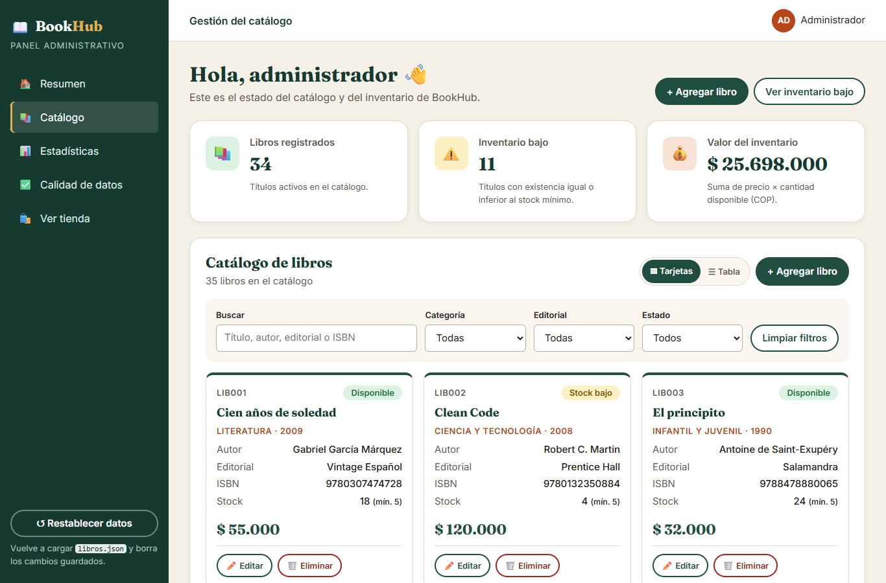
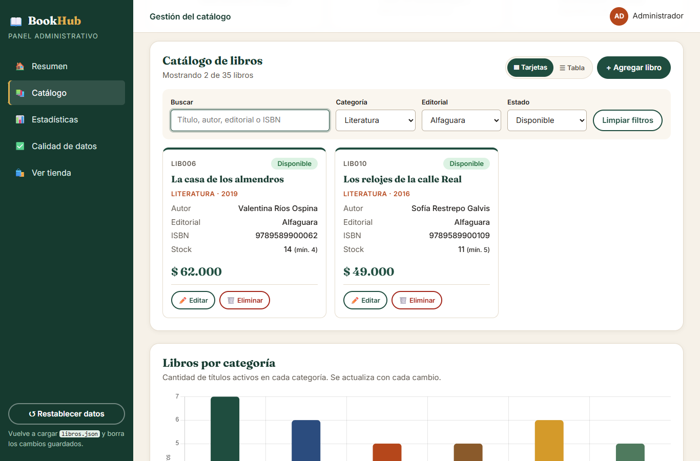
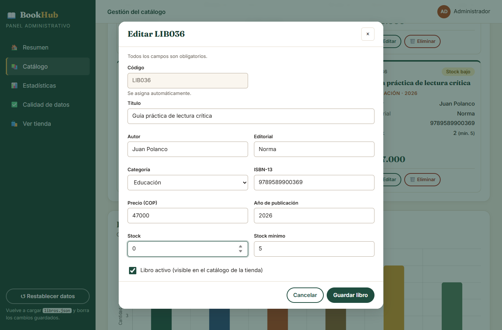
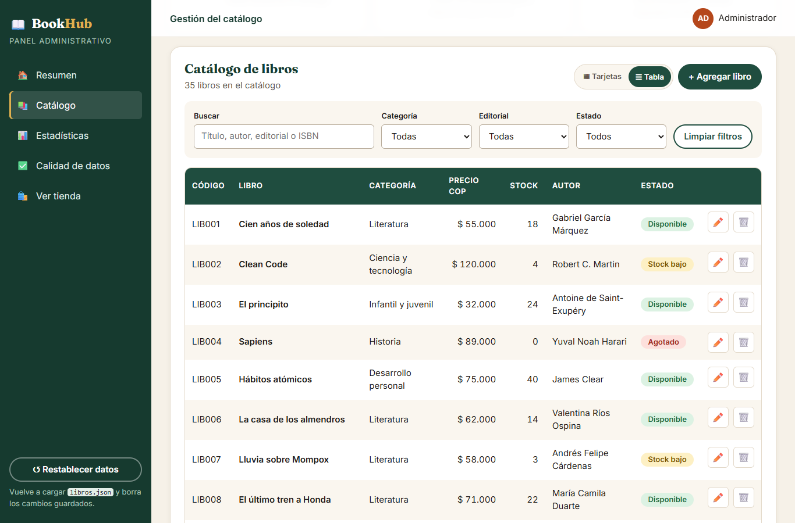
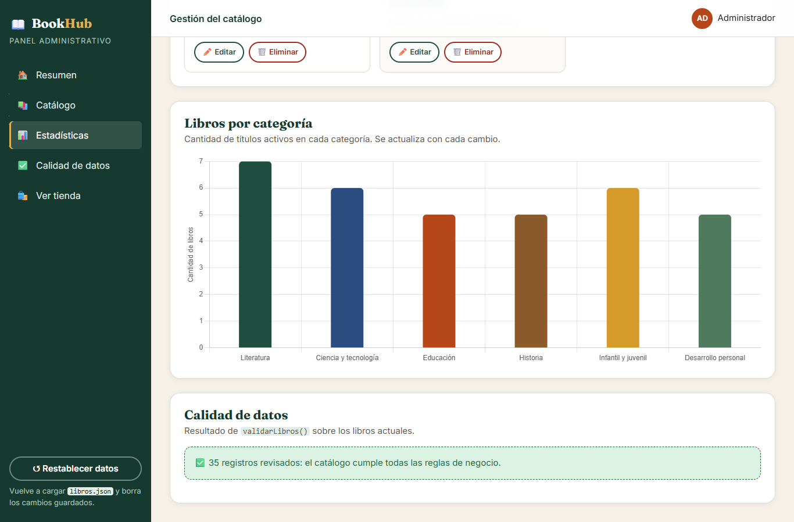
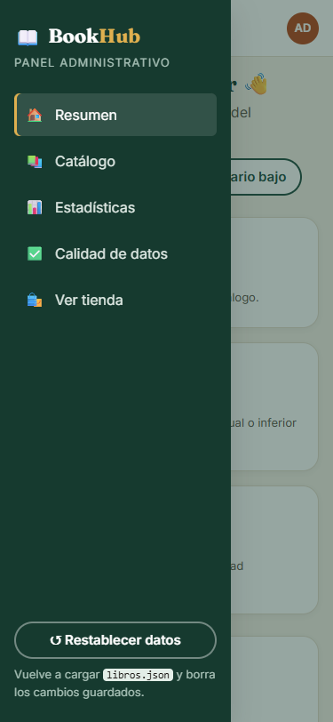
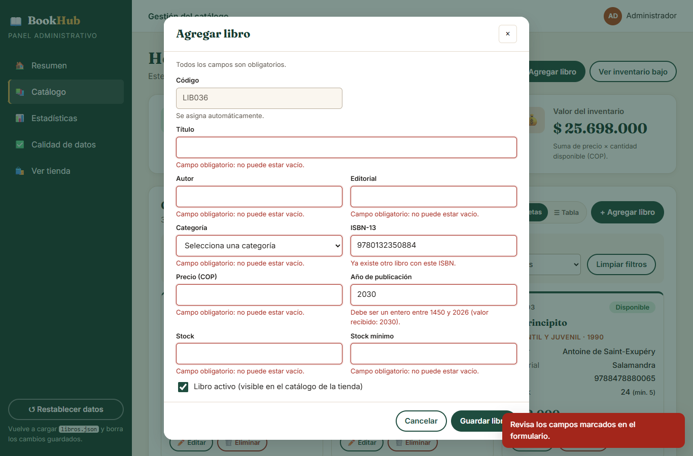

# Taller 2 · IA en proyectos web: BookHub

**Proyecto:** BookHub, una librería digital colombiana de libros impresos.
**Autor:** Juan Polanco (ujuanpolanco) · CampusLands · Skill IA para JavaScript
**Tecnologías:** HTML5 · CSS3 · JavaScript vanilla · JSON · DOM · localStorage · Chart.js · Prompt Engineering



## Descripción

Este repositorio reúne los resultados del *Taller práctico BookHub: construcción de una plataforma web para comercio electrónico de libros usando inteligencia artificial*. El prototipo se construyó por fases, usando la IA como asistente y aplicando priming, meta-prompting, zero-shot, one-shot, few-shot, chain of thought y role prompting. Además, se generó un **dataset sintético** de libros que se validó con JavaScript antes de usarlo en la interfaz.

El MVP incluye:

- **Landing page** con la presentación de la librería, categorías, libros destacados y novedades, beneficios, reseñas y suscripción.
- **Panel administrativo** con sidebar responsive (menú hamburguesa), 3 KPI, catálogo en tarjetas o tabla, búsqueda y filtros combinados, CRUD con modal, persistencia en localStorage, gráfico por categoría y reporte de calidad de datos.
- **Dataset** de 35 libros (5 manuales con ISBN verificado y 30 generados con IA), validado con `validarLibros()`.

No usa frameworks (React, Vue, Bootstrap ni Tailwind). La única librería externa es Chart.js, solo para el gráfico.

## Cómo ejecutarlo

`dashboard/app.js` carga `libros.json` con `fetch()`, así que el proyecto **debe abrirse desde un servidor local** y no con doble clic (`file://`).

**Opción 1: VS Code + Live Server.** Abrir la carpeta del repositorio, clic derecho en `landing/index.html` → *Open with Live Server*.

**Opción 2: Python.** Desde la raíz del repositorio:

```powershell
python -m http.server 5500
```

Luego abrir:

- Landing: http://localhost:5500/landing/index.html
- Dashboard: http://localhost:5500/dashboard/index.html

Para validar el dataset desde la consola (requiere Node.js):

```powershell
node dataset/validar-dataset.js dashboard/libros.json
```

> Se necesita conexión a internet para las fuentes de Google Fonts, las imágenes de ejemplo (placehold.co) y Chart.js. Sin conexión, la página funciona con las fuentes del sistema y muestra un aviso en lugar del gráfico.

## Estructura del repositorio

```
Taller-2-IA-en-proyectos-web/
├── README.md
├── landing/                      # Fase 1: landing page
│   ├── index.html
│   ├── styles.css
│   └── script.js                 # Menú móvil y validación del formulario
├── dashboard/                    # Fases 2, 4 y 5: panel administrativo + CRUD
│   ├── index.html
│   ├── styles.css
│   ├── app.js                    # Carga, renderizado, filtros, CRUD, localStorage, KPI, gráfico
│   ├── validacion.js             # validarLibros() y reglas del dataset
│   └── libros.json               # Dataset final (35 libros)
├── compartido/
│   └── menu.js                   # Menú hamburguesa reutilizable (landing y dashboard)
├── dataset/                      # Fases 3 y 4: generación y validación
│   ├── libros-ejemplo.js         # 5 registros manuales
│   ├── libros-v1-sin-corregir.json
│   ├── casos-prueba-errores.json
│   ├── validar-dataset.js
│   └── reportes/                 # Salida de validarLibros()
├── docs/                         # Informe
│   ├── 01-registro-de-prompts.md
│   ├── 02-propuesta-de-diseno.md
│   ├── 03-dataset.md
│   ├── 04-reporte-de-validacion.md
│   ├── 05-pruebas-y-evidencias.md
│   └── 06-reflexion.md
└── evidencias/                   # 19 capturas de pantalla
```

## Entregables

| Entregable | Ubicación |
|---|---|
| Landing page funcional: `index.html` y `styles.css` | [landing/](landing) |
| Dashboard administrativo con la identidad visual de BookHub | [dashboard/index.html](dashboard/index.html) · [dashboard/styles.css](dashboard/styles.css) |
| Dataset `libros.json` con 5 registros manuales y 30 generados con IA | [dashboard/libros.json](dashboard/libros.json) · [docs/03-dataset.md](docs/03-dataset.md) |
| `validacion.js` y evidencia del reporte de validación | [dashboard/validacion.js](dashboard/validacion.js) · [dataset/reportes/](dataset/reportes) · [docs/04-reporte-de-validacion.md](docs/04-reporte-de-validacion.md) |
| Aplicación CRUD: `app.js`, estilos y HTML | [dashboard/app.js](dashboard/app.js) |
| Capturas: landing, dashboard, filtros, modal y gráfico | [evidencias/](evidencias) · [docs/05-pruebas-y-evidencias.md](docs/05-pruebas-y-evidencias.md) |
| Documento con los prompts, la técnica aplicada y los ajustes a las respuestas de la IA | [docs/01-registro-de-prompts.md](docs/01-registro-de-prompts.md) |
| Propuesta de diseño (Chain of Thought) | [docs/02-propuesta-de-diseno.md](docs/02-propuesta-de-diseno.md) |
| Preguntas de reflexión | [docs/06-reflexion.md](docs/06-reflexion.md) |

## Cumplimiento de la rúbrica

| Criterio | Peso | Dónde se evidencia |
|---|---|---|
| Prompt Engineering y documentación del proceso | 15 % | 15 prompts documentados con técnica, resultado y ajustes ([01](docs/01-registro-de-prompts.md)) |
| Landing page y diseño responsive | 15 % | HTML semántico, mobile-first, menú accesible, formulario validado (capturas 01–05) |
| Dashboard y presentación de indicadores | 15 % | Sidebar de 5 opciones, 3 KPI calculados, tabla de 7 columnas con badges y acciones (capturas 06–10) |
| Dataset y generación con IA | 15 % | 35 libros en JSON válido; ISBN reales verificados e ISBN simulados documentados ([03](docs/03-dataset.md)) |
| Validación programática | 15 % | `validarLibros()` con dígito de control del ISBN, reportes antes y después, 19/19 errores de prueba detectados ([04](docs/04-reporte-de-validacion.md)) |
| CRUD, filtros y localStorage | 20 % | Crear, leer, editar y eliminar con confirmación; 4 filtros combinables; persistencia verificada al recargar (capturas 11–16) |
| Gráfico estadístico | 5 % | Chart.js por categoría, se actualiza en cada operación (captura 17) |

## Capturas

| Landing (1280 px) | Landing móvil (360 px) |
|---|---|
|  |  |

| Catálogo con filtros combinados | Modal de edición |
|---|---|
|  |  |

| Tabla de inventario | Gráfico por categoría |
|---|---|
|  |  |

| Menú hamburguesa (375 px) | Validación del formulario |
|---|---|
|  |  |

## Nota sobre los datos

- Los registros **LIB001 a LIB005** son libros reales. Su ISBN, editorial y año se verificaron en Open Library.
- Los registros **LIB006 a LIB035** son **datos simulados** para el prototipo: títulos, autores e ISBN de prueba (prefijo `978958990`) con dígito de control válido. No corresponden a publicaciones reales.
- Las reseñas y los nombres de la landing son ficticios. El proyecto no contiene datos personales reales.
